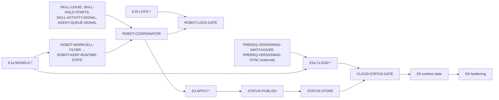

# Workcell-Sync: Jira Plan

Source: [TDD to Address Problems with Floorplan Sync](https://docs.google.com/document/d/1joiC9p6Py1CSHtHbJ09iUK61qZR_ACJGYis5phH-g8Q) (referred to below as "TDD"). Section names in **TDD** fields refer to that document.

## How to read this

- **Epics** follow the TDD roll-out phases (1a to 6), plus E0 for work that can start now and E7 for follow-up work.
- **IDs** are local to this plan. The prefix shows the area: `FIX` (independent audit fixes), `SPIKE` (investigations and decisions), `MODELS` (models project), `LOCK` and `WFE` (workflow-execution), `CLOUD` (workcell-monolith and other cloud services), `ROBOT` and `APPLY` (ar-mgmt), `SKILL` (ar-skill-caller), `AGENT` (temporal-agent), `STATUS` (sync status across services), `STATE` (runtime state on the robot), `UI` (frontend), `OUTBOX` and `ALERT` (hardening), `FOLLOW` (follow-up work). Replace the IDs with Jira keys when the tickets are created.
- **Size:** S = up to 2 days, M = up to a week, L = more than a week. Teams refine these.
- **Depends on** lists hard dependencies: the ticket cannot be finished until those are done. **Soft** dependencies are noted separately and only affect testing or rollout.
- **Acceptance criteria** start with the failing test to write first where a test applies.
- **External** dependencies are outside this plan (for example the versioning switchover).

## Lanes and parallelization

Work splits into five lanes that run in parallel. Within a lane, tickets run in the order listed unless they say otherwise.

| Lane | Area | Epics and tickets |
|---|---|---|
| A | workcell-monolith, database-migration, agility-infra, object-library, CatDe GitHub Action | 2a, CLOUD-STATUS-GATE, CLOUD-TOTE-CONSUMER, CLOUD-OVERRIDE-DELIVERY, E7 |
| B | workflow-execution | 1b, CLOUD-RUNNING-CHECK (workflow-execution side), WFE-HELD-REASON |
| C | ar-mgmt | ROBOT-WORKCELL-FILTER through ROBOT-KEEP-RUNTIME-STATE (including ROBOT-SQLITE-STORE), ROBOT-ZENOH-CLIENT, ROBOT-COORDINATOR through ROBOT-ROLLBACK-FLAG, E3, STATUS-PUBLISH, ROBOT-OVERRIDE-APPLY |
| D | ar-skill (ar-skill-caller, temporal-agent) | SKILL-LEASE through AGENT-QUEUE-SIGNAL, SKILL-HELD-REASON, STATE-TOTE-EVENT, STATE-PAIRED-WRITE, E6 |
| E | device-manager, message-handler, frontend | FIX-FACILITY-MOVE-UNASSIGN, CLOUD-STARTUP-RESPONSE, STATUS-STORE, UI-SYNC-STATUS, STATUS-CONTRACT-TEST, UI-STATE-ENDPOINT |

Shared: the models project (1a) is a short first step that lanes A, C and E consume.

## Critical path

The longest chain runs through the robot lane: lease and signals, coordinator, robust apply, sync status, then the cloud gate that reads it. The cloud lane (2a) waits on the external versioning switchover and can otherwise run alongside the robot lane.

## Summary

| Epic | Phase | Can start | Blocked by |
|---|---|---|---|
| E0 | Independent fixes and spikes | Now | Nothing |
| E1a | Message models | Now | Nothing |
| E1b | Workflow lock publisher | Now | SPIKE-LOCK-FAILURE (for LOCK-PUBLISH-FAILURE only) |
| E2a | Cloud publish path, part 1 | After versioning switchover | 1a, PREREQ-VERSIONING-SWITCHOVER, PREREQ-VERSIONING-SYNC |
| E2b | Robot-only safety changes | Now | 1a, SPIKE-TTLS, LOCK-SCHEMA |
| E3 | Robust apply | After ROBOT-COORDINATOR | 2b, SPIKE-PRIVILEGE, FIX-FACILITY-MOVE-UNASSIGN |
| E4 | Protocol and cloud publish path, part 2 | After APPLY-PERSIST and CLOUD-COORDINATOR | 2a, E3, SPIKE-GATE-FAILED-ROBOT |
| E5 | Runtime state | After E4 | CLOUD-STATUS-GATE, SPIKE-PAUSE-OVERRIDE, FIX-TOTE-INGEST |
| E6 | Hardening | After E5 | E5 |
| E7 | Follow-up work | After 2a | 2a |

---

## Prerequisites (external)

These are outside this plan and are tracked with the owning team. Tickets that need them list them under **Depends on**.

#### PREREQ-VERSIONING-SWITCHOVER Floorplan versioning switchover
- **Owner:** Floorplan Versioning TDD authors
- **Needed by:** CLOUD-LEDGER-TABLE and the rest of E2a
- **TDD:** Dependency 1
- **Description:** The version table, live pointer, and annotation state table from the Floorplan Versioning TDD must be live, including custom attributes on draft annotations.

#### PREREQ-VERSIONING-SYNC Versioning sync path and flag-off fallback
- **Owner:** Floorplan Versioning TDD authors (pending an answer from Brad)
- **Needed by:** CLOUD-GEN-ON-PUBLISH, CLOUD-FLAG
- **TDD:** Dependency 1; Deployment
- **Description:** Today, Go Live and promotion in workcell-monolith publish a version without a workflow check and without a sync. This plan needs to know whether the versioning switchover adds a sync on Go Live and promotion, whether that sync includes the workflow check, and therefore what publishing does when the delivery coordinator flag is off. It also needs to know whether Go Live and promotion apply charge dock assignment changes to device-manager. Drafts store a charger's chargeDockId, but neither publish path calls the assignment helpers today; when they do, they should use the helpers fixed in FIX-DOCK-ASSIGN inside the publish transaction.

---

## E0: Independent fixes and spikes

These have no dependency on the rest of the plan. The fixes come from TDD Appendix A ("Fixes independent of this design"). The spikes answer open questions that block later tickets.

### Fixes

#### FIX-KEEPOUT-BOX Fix keep-out zone box size at negative coordinates (B9)
- **Jira:** [SWSS-3329](https://agilityrobotics.atlassian.net/browse/SWSS-3329)
- **Area:** ar-mgmt (`FloorplanService.getBoundingBoxDimensions`)
- **Size:** S
- **Depends on:** none
- **TDD:** Appendix A, B9
- **Description:** The bounding box calculation initializes `maxX` and `maxY` with `Double.MIN_VALUE`, which is the smallest positive double, so zones with only negative coordinates get the wrong size.
- **Acceptance criteria:**
  - Failing test first: a zone whose points all have negative x and y produces the correct width and height.
  - Initial maxima use `-Double.MAX_VALUE` (or equivalent).

#### FIX-WS-HANDLERS Remove WebSocket response handlers after use (B12)
- **Jira:** [SWSS-3330](https://agilityrobotics.atlassian.net/browse/SWSS-3330)
- **Area:** ar-mgmt (`JsonWebSocketClient`)
- **Size:** S
- **Depends on:** none
- **TDD:** Appendix A, B12
- **Acceptance criteria:**
  - Failing test first: after N queries complete, the handler map is empty.
  - Handlers are removed on response, on error, and on timeout.

#### FIX-DOCK-ASSIGN Make charge dock assignment sync reliable (A16)
- **Jira:** [SWSS-3331](https://agilityrobotics.atlassian.net/browse/SWSS-3331)
- **Area:** workcell-monolith (`FloorplanService.assignChargeDockToWorkcellViaFloorplan`, `unassignChargeDockFromWorkcell`)
- **Size:** M
- **Depends on:** none
- **TDD:** Appendix A, A16
- **Description:** The device-manager calls run in `afterCommit()` and only log a failure, so a failed call leaves the annotation committed with a charge dock that device-manager never learns about, and a retry of the same request does nothing because the stored dock already matches. The calls move inside the transaction, before commit, and a failure throws, so the annotation change rolls back and a retry redoes the whole change.
- **Acceptance criteria:**
  - Failing test first: when device-manager returns an error during a charge dock change, the request fails and the annotation's charge dock is unchanged in the database.
  - A retry of the same request after a device-manager failure assigns the dock.
  - Device-manager calls run inside the transaction, before commit, and a failure throws an exception.
  - "No workcell" and "multiple workcells" for the floorplan throw instead of logging and skipping. (Multiple workcells cannot happen in practice; throwing keeps the code honest.)
  - Device-manager's assign and unassign are confirmed to be idempotent.
  - Fixing the shared helpers covers every current caller. Go Live and promotion do not call them yet, so a charge dock change made through a draft never reaches device-manager. That gap is tracked under PREREQ-VERSIONING-SYNC.

#### FIX-FACILITY-MOVE-UNASSIGN Tell the robot when a facility move clears its workcell (D11, D16)
- **Jira:** [SWSS-3332](https://agilityrobotics.atlassian.net/browse/SWSS-3332)
- **Area:** device-manager (`DeviceService.returnDevices`, `DeviceService.assignDevicesToFacility`)
- **Size:** M
- **Depends on:** none
- **TDD:** Appendix A, D11 and D16; Startup fallback
- **Description:** Facility assignment is a database-only change, and robots only know their workcell. Both methods also set the device's workcellId to null, but neither sends the workcell change to the robot through `sendWorkcellToDevice`, the path an ordinary workcell change uses. The robot keeps its stale retained workcell assignment and keeps syncing the old workcell's floorplan.
- **Acceptance criteria:**
  - Failing test first: returning a device that was assigned to a workcell sends a workcell update with no workcell, through the same path as an ordinary workcell change. Same for `assignDevicesToFacility`.
  - A device that had no workcell sends nothing.
  - Confirm what an ordinary workcell change to "none" publishes on the assignment topic. If it is not a retained message with no workcellId, change it to one; that is the Unassign message that APPLY-UNASSIGN and the startup fallback rely on.
#### FIX-TOTE-INGEST Confirm tote event ingestion in every environment (A22)
- **Jira:** [SWSS-3333](https://agilityrobotics.atlassian.net/browse/SWSS-3333)
- **Area:** Services / environment config
- **Size:** S
- **Depends on:** none
- **TDD:** Open Questions, Other; Phase 5
- **Acceptance criteria:**
  - Ingestion is enabled, or the reason it is disabled (for example in the Mercado Libre environment) is documented.
  - Required before STATE-TOTE-EVENT ships.

### Spikes

Each spike ends with a written answer added to the TDD.

#### SPIKE-PRIVILEGE Does `command_privilege` release the privilege after a skill?
- **Area:** core/skill
- **Size:** S
- **Blocks:** APPLY-PRIVILEGE
- **TDD:** Open Questions, Skills and Solutions; Apply lease
- **Acceptance criteria:**
  - Determine whether the skill server keeps its ar-control connection, and the privilege, between requests.
  - If it does, decide between dropping the privilege on exit in the decorator or having the coordinator request at priority 0.

#### SPIKE-TTLS Choose the lease TTL and hold TTL
- **Area:** ar-mgmt, ar-skill
- **Size:** S
- **Blocks:** SKILL-LEASE, SKILL-HOLD-STARTS
- **TDD:** Open Questions, Services Team; Risk 3
- **Acceptance criteria:**
  - Measured apply times for typical and large floorplans, with and without a localization reset and set-up-workcell.
  - Proposed lease TTL, renewal cadence, and hold TTL, each with its reasoning.

#### SPIKE-RETRYABLE-START Decide on a retryable error type for rejected held starts
- **Area:** workflow-execution
- **Size:** S
- **Blocks:** WFE-RETRYABLE-START (optional)
- **TDD:** Apply lease; Risk 3
- **Acceptance criteria:**
  - Decision on whether a start rejected after the hold TTL should be retried, and how many attempts are allowed.

#### SPIKE-ECS-WRITERS Find clients that start skills or write ECS outside ar-skill-caller
- **Area:** Skills and Solutions
- **Size:** S
- **Blocks:** none (informs APPLY-PRIVILEGE)
- **TDD:** Open Questions, Skills and Solutions; Dependency 3
- **Acceptance criteria:**
  - Whether Tasker runs on production robots.
  - List of other clients or processes that write ECS outside a skill.

#### SPIKE-LOCK-FAILURE Decide what a workflow does when the lock publish fails
- **Area:** workflow-execution
- **Size:** S
- **Blocks:** LOCK-PUBLISH-FAILURE
- **TDD:** Workflow lock (Publish failure)
- **Acceptance criteria:**
  - Decision between waiting and starting anyway, with retry and timeout values if waiting.

#### SPIKE-PAUSE-OVERRIDE Decide whether a state-override can be delivered while a workflow is paused
- **Area:** Product / Services
- **Size:** S
- **Blocks:** CLOUD-OVERRIDE-DELIVERY, UI-STATE-ENDPOINT
- **TDD:** Open Questions, Services Team
- **Acceptance criteria:**
  - Decision, and the resulting UI rule for offering state-overrides during a pause.

#### SPIKE-GATE-FAILED-ROBOT Decide whether the cloud gate ignores FAILED or long-DEFERRED robots
- **Area:** Services
- **Size:** S
- **Blocks:** CLOUD-STATUS-GATE
- **TDD:** Open Questions, Services Team
- **Acceptance criteria:**
  - Decision, with the threshold if a long DEFERRED status is ignored.

---

## E1a: Message models

- **Area:** agility-services/package/models (published to Artifactory)
- **TDD:** Phase 1a; Deployment; Schema Contract and Versioning
- **Parallel with:** E0, E1b. Short; do it first.

#### MODELS-FLOORPLAN-FIELDS Add the new floorplan message fields
- **Size:** S
- **Depends on:** none
- **Acceptance criteria:**
  - Failing test first: a payload with `schemaVersion`, `version`, `generation`, and `snapshotHash` round-trips.
  - A payload without them still deserializes (fields optional).
  - Unknown properties are still ignored.

#### MODELS-SYNC-STATUS Add the sync status message (protobuf)
- **Size:** S
- **Depends on:** none
- **Acceptance criteria:**
  - Defined in protobuf under `package/models/src/main/proto`, alongside the existing `agility/events/v1` definitions, with generated Java in the models artifact.
  - Fields as in the TDD Schema Contract: workcellId, applied and pending version and generation, appliedStateOverrideSequence, state, reason, outboxDepth, busy, skippedAnnotations, timestamp.
  - Round-trip serialization test, and the models project's breaking-change check passes.

#### MODELS-STATE-OVERRIDE Add the state-override message (protobuf)
- **Size:** S
- **Depends on:** none
- **Acceptance criteria:**
  - Defined in protobuf in the models project, like MODELS-SYNC-STATUS.
  - workcellId, schemaVersion, and an ordered list of entries with sequence, objectId, `before`, and `after`.
  - `before` and `after` are a shared state message whose attributes (`count`, `available`) are proto3 `optional`, so an unset attribute is absent, not 0 or false.
  - Round-trip serialization test, and the breaking-change check passes.

#### MODELS-RELEASE Publish the models and update consumers
- **Size:** S
- **Depends on:** MODELS-FLOORPLAN-FIELDS, MODELS-SYNC-STATUS, MODELS-STATE-OVERRIDE
- **Acceptance criteria:**
  - New models version in Artifactory.
  - ar-mgmt, workcell-monolith, and device-manager build against it.

---

## E1b: Workflow lock publisher

- **Area:** workflow-execution (Python)
- **TDD:** Phase 1b; Workflow lock; Dependency 2
- **Parallel with:** E1a, E0, E2b. Needs no robot changes.

#### LOCK-SCHEMA Define the workflow lock message and topic
- **Size:** S
- **Depends on:** none
- **Acceptance criteria:**
  - Retained per-robot topic.
  - Payload holds the workflowRunId of the robot's active online workflow or an explicit idle value, plus the time of the event it reports.
  - Schema shared with ar-mgmt (models project or a documented contract).

#### LOCK-ON-START Publish the lock when a workflow starts
- **Size:** M
- **Depends on:** LOCK-SCHEMA
- **Acceptance criteria:**
  - Failing test first: starting a workflow publishes the lock for each involved robot before the first task request is sent.
  - Covers pool workflows: the lock goes to the robot the workflow actually runs on.

#### LOCK-ON-END Publish idle when a workflow reaches a terminal state
- **Size:** S
- **Depends on:** LOCK-SCHEMA
- **Acceptance criteria:**
  - Failing test first: completed, failed, and canceled workflows each publish the idle value.

#### LOCK-ON-TERMINATE Terminate path: emit an event and publish idle
- **Size:** S
- **Depends on:** LOCK-SCHEMA
- **Acceptance criteria:**
  - Failing test first: `remove_workflow` emits `WorkflowExecutionTerminated` on Kafka and publishes the idle value.

#### LOCK-RECONCILE Reconciliation loop
- **Size:** M
- **Depends on:** LOCK-ON-START, LOCK-ON-END
- **Acceptance criteria:**
  - Periodically republishes each robot's current value (active workflowRunId or idle).
  - Recovers a lost retained message and a crash between a terminal state and its publish.
  - Publishes idle only if the robot is still idle at publish time, so it cannot overwrite a workflow that just started.

#### LOCK-PUBLISH-FAILURE Handle a failed lock publish at workflow start
- **Size:** S
- **Depends on:** LOCK-ON-START, SPIKE-LOCK-FAILURE
- **Acceptance criteria:**
  - Implements the SPIKE-LOCK-FAILURE decision, with a test for the failure case.

---

## E2a: Cloud publish path, part 1

- **Area:** workcell-monolith (lane A); workflow-execution for CLOUD-RUNNING-CHECK
- **TDD:** Phase 2a; Cloud publish path; Delivery ledger; Delivery coordinator; Fixes to the workflow-running check
- **External dependency:** PREREQ-VERSIONING-SWITCHOVER, PREREQ-VERSIONING-SYNC
- **Parallel with:** all robot work (E2b, E3)

#### CLOUD-LEDGER-TABLE Add the delivery ledger and state-override tables
- **Size:** S
- **Depends on:** PREREQ-VERSIONING-SWITCHOVER
- **Area:** package/database-migration (public schema)
- **Acceptance criteria:**
  - `floorplan_delivery_ledger` with the columns in the TDD, one row per workcell, in the versioning migration series.
  - `floorplan_pending_state_override` with the columns in the TDD, created now so that both tables join CDC in one pass (CLOUD-CDC-PUBLICATION). E5 adds the code that writes it.

CDC onboarding for these tables follows the same steps as SWSS-3100 (device.device): grant and publication in database-migration, then a Kafka topic and the connector change in agility-infra. The delivery coordinator consumes the raw Debezium events, because a ledger row carries everything an evaluation needs, so no Kafka Streams topology is required.

#### CLOUD-CDC-PUBLICATION Grant SELECT and add the tables to the Debezium publication
- **Size:** S
- **Depends on:** CLOUD-LEDGER-TABLE
- **Area:** package/database-migration (public schema)
- **Reference:** SWSS-3102; PR #5322
- **Acceptance criteria:**
  - A migration grants SELECT on both tables to `replication_user` and adds them to `debezium_pub`, idempotently.
  - `debezium_pub` is owned by `replication_user` (public/V69), and ALTER PUBLICATION needs ownership or membership in the owning role. The migration therefore makes the migration user a member of `replication_user` before it alters the publication, as device/V17 does after PR #5322.
  - Failing test first, in `test/test_flyway_migration.py`: the migration runs as a non-superuser migration user that does not own the publication, and afterwards both tables are in `debezium_pub` and `replication_user` has SELECT on them. (Tests that migrate as the superuser skip the ownership check and would pass anyway.)

#### CLOUD-CDC-TOPICS Add the Kafka topics for the new tables
- **Size:** S
- **Depends on:** none
- **Area:** agility-infra
- **Reference:** SWSS-3106
- **Acceptance criteria:**
  - Topics for the ledger and state-override change events exist in every environment, following the naming and retention of the existing CDC topics.

#### CLOUD-CDC-CONNECTOR Add the tables to the Debezium connector
- **Size:** S
- **Depends on:** CLOUD-CDC-PUBLICATION, CLOUD-CDC-TOPICS
- **Area:** agility-infra
- **Reference:** SWSS-3101
- **Acceptance criteria:**
  - The connector includes both tables and routes their events to the new topics.
  - A change to a ledger row produces an event on its topic in a test environment.

#### CLOUD-GEN-ON-PUBLISH Increment the generation on publish and promotion
- **Size:** M
- **Depends on:** CLOUD-LEDGER-TABLE, PREREQ-VERSIONING-SYNC
- **Acceptance criteria:**
  - Failing test first: Go Live and promotion each upsert the ledger row (desired_generation + 1, status PENDING) in the same transaction as the version write.
  - A rollback of the transaction leaves the ledger unchanged.
  - Concurrent publishes are serialized by the floorplan row lock.

#### CLOUD-GEN-EXTERNAL Increment the generation for object-library and CatDe changes
- **Size:** M
- **Depends on:** CLOUD-LEDGER-TABLE
- **Area:** workcell-monolith, object-library sync, CatDe GitHub Action
- **Acceptance criteria:**
  - An endpoint increments desired_generation for every affected workcell.
  - Callers retry retryable errors until acknowledged; a duplicate call is safe.

#### CLOUD-RUNNING-CHECK Fix the workflow-running check
- **Size:** M
- **Depends on:** none
- **Area:** workflow-execution and workcell-monolith (`workcellHasActiveWorkflows`)
- **Acceptance criteria:**
  - Failing tests first:
    - A non-2xx response counts as running.
    - A response without a data array counts as running.
    - A missing organization_id counts as running.
    - A PAUSED workflow counts as running.
  - The query filters by workcell in the database.

#### CLOUD-COORDINATOR Delivery coordinator: evaluation and publish
- **Size:** L
- **Depends on:** CLOUD-LEDGER-TABLE, CLOUD-CDC-CONNECTOR, CLOUD-RUNNING-CHECK, CLOUD-SNAPSHOT-HASH, MODELS-RELEASE
- **Soft:** LOCK-ON-TERMINATE (terminated events)
- **Acceptance criteria:**
  - Consumes the raw Debezium events for the ledger and workflow terminal-state events from Kafka.
  - For a pending workcell: evaluates the gate, builds the message with generation G and snapshotHash, publishes it retained at QoS 2, and waits for the delivery token.
  - Conditional write sets published_generation to G only if desired_generation is still G (test with a concurrent increment).
  - Two concurrent evaluations of one workcell produce at most a duplicate publish of the same generation.

#### CLOUD-SETTLE-RETRY Settle interval and retry timer
- **Size:** M
- **Depends on:** CLOUD-COORDINATOR
- **Acceptance criteria:**
  - A burst of triggers within the settle interval produces one publish.
  - A workcell left pending by a closed gate, failed check, or failed publish is re-evaluated on a fixed interval with jitter.

#### CLOUD-FLAG Feature flag and fallback
- **Size:** S
- **Depends on:** CLOUD-COORDINATOR, PREREQ-VERSIONING-SYNC
- **Acceptance criteria:**
  - The delivery coordinator runs behind a flag.
  - With the flag off, publishing uses the fallback that PREREQ-VERSIONING-SYNC defines.

#### CLOUD-SNAPSHOT-HASH Compute snapshotHash from the message inputs
- **Size:** S
- **Depends on:** MODELS-FLOORPLAN-FIELDS
- **Acceptance criteria:**
  - Failing test first: the hash is stable across key order and rendering, and changes when the object set or a referenced CatDe changes.
  - Excludes generation, publishedAt, and all state values.

---

## E2b: Robot-only safety changes

- **Area:** ar-mgmt (lane C); ar-skill (lane D) for SKILL-LEASE through AGENT-QUEUE-SIGNAL
- **TDD:** Phase 2b; Robot sync coordinator; Gate signals; Apply lease
- **Parallel with:** E2a. Tickets ROBOT-WORKCELL-FILTER through ROBOT-KEEP-RUNTIME-STATE can start as soon as MODELS-RELEASE lands. Gate signals and the lease use Zenoh: liveliness tokens for producer liveness and Zenoh queries for the lease request and response.

#### ROBOT-WORKCELL-FILTER Discard messages for other workcells
- **Size:** S
- **Depends on:** none
- **Acceptance criteria:**
  - Failing test first: a message whose workcellId differs from the current assignment is not applied.

#### ROBOT-MSG-HASH Compare messages by a robot-computed hash
- **Size:** M
- **Depends on:** MODELS-RELEASE
- **Acceptance criteria:**
  - Failing tests first:
    - A message equal to the applied one, except for runtime state, is ignored.
    - An ar-mgmt restart does not reapply an unchanged retained message.
  - Replaces the messageId idempotent receiver for the floorplan topic.
  - Uses generation when present.

#### ROBOT-TOLERANT-PARSE Parse annotations one at a time
- **Size:** S
- **Depends on:** MODELS-RELEASE
- **Acceptance criteria:**
  - Failing test first: an annotation of an unknown type is skipped and reported, and the rest of the message is applied.

#### ROBOT-SQLITE-STORE Add a SQLite store to ar-mgmt
- **Size:** S
- **Depends on:** none
- **Area:** ar-mgmt
- **TDD:** Robot sync coordinator (persisted applied state)
- **Acceptance criteria:**
  - ar-mgmt keeps its local state in a SQLite database on the robot's persistent storage, through a single small repository class.
  - Tables for the applied state (generation, version, map data hash) and for the object UUID to model manifest hash map, created by a versioned schema migration at startup.
  - Writes for one apply are committed in a single transaction, so a crash leaves either the old or the new applied state.
  - Failing test first: after a simulated restart, the repository returns what was committed before it, and nothing from an uncommitted transaction.
  - Adding the SQLite JDBC driver is a new dependency for ar-mgmt and needs the usual approval.

#### ROBOT-LOCALIZATION-RESET Reset localization only when map data change
- **Size:** M
- **Depends on:** ROBOT-SQLITE-STORE
- **Acceptance criteria:**
  - Failing test first: an apply with unchanged map image, origin, resolution, and April tag landmarks does not stop localization.
  - The hash of the map data is stored in the SQLite store next to the applied state.
  - A missing session (GetWorkCellLocalizationInfo) still triggers a reset.

#### ROBOT-KEEP-RUNTIME-STATE Leave runtime state alone on existing objects
- **Size:** S
- **Depends on:** none
- **Acceptance criteria:**
  - Failing test first: applying a snapshot to an existing tote stack keeps its count and availability.
  - New objects still receive the snapshot values.

#### SKILL-LEASE Apply lease interface in ar-skill-caller
- **Size:** M
- **Depends on:** SPIKE-TTLS
- **Acceptance criteria:**
  - acquireApplyLease, renewApplyLease, releaseApplyLease, exposed as Zenoh queries, with a lease ID and expiry.
  - Granted only when no skill or offline block is running and no workflow is paused; a denial carries a reason.
  - One lease at a time, and a lease expires if not renewed.
  - Failing test first: after ar-skill-caller restarts, it refuses new starts for one lease time-to-live, and a renewal of a lease granted before the restart is rejected.

#### SKILL-HOLD-STARTS Hold starts while the lease is held
- **Size:** M
- **Depends on:** SKILL-LEASE
- **Acceptance criteria:**
  - Failing tests first:
    - Block starts, offline block starts, recovery skills, resume, and reset are held during a lease.
    - stop and pause pass through.
  - A held start proceeds when the lease is released.
  - A start held longer than the hold TTL is rejected.

#### SKILL-ACTIVITY-SIGNAL Skill activity signal
- **Size:** M
- **Depends on:** none
- **Acceptance criteria:**
  - Publishes busy, controlState, workflowRunId, and timestamp on Zenoh, with a liveliness token.

#### AGENT-QUEUE-SIGNAL Event queue signal from temporal-agent
- **Size:** M
- **Depends on:** none
- **Acceptance criteria:**
  - Reports pending and leased rows per stream, oldest pending age, and maximum attempt count on Zenoh, with a liveliness token.

#### ROBOT-ZENOH-CLIENT Add a Zenoh client to ar-mgmt
- **Size:** S
- **Depends on:** none
- **TDD:** Gate signals
- **Acceptance criteria:**
  - ar-mgmt can subscribe to a Zenoh key, observe a liveliness token, and send a Zenoh query with a timeout, using the Zenoh Java client.
  - A failing test first shows that a missing liveliness token is reported as not live.

#### ROBOT-COORDINATOR Coordinator skeleton and apply gate
- **Size:** L
- **Depends on:** SKILL-LEASE, SKILL-ACTIVITY-SIGNAL, AGENT-QUEUE-SIGNAL, ROBOT-ZENOH-CLIENT
- **Acceptance criteria:**
  - Single-threaded with Idle, Deferred, and Applying states; latest generation wins.
  - Applies only with the lease and an open gate: empty outbox, ar-control connected and not paused, all signals live. The empty-outbox condition applies to floorplan applies only (state-overrides use compare-and-set, ROBOT-OVERRIDE-APPLY).
  - Reports DEFERRED and retries on a gate change.

#### ROBOT-LOCK-GATE Workflow lock gate condition
- **Size:** M
- **Depends on:** ROBOT-COORDINATOR, LOCK-SCHEMA
- **Acceptance criteria:**
  - Failing tests first:
    - The gate stays closed while the lock holds a workflowRunId.
    - The condition is inactive until the first lock message for the current assignment.
    - The lock is treated as unknown while MQTT is disconnected.
    - An older lock message does not overwrite a newer one.
  - The lock is checked before the lease request and again after the grant.

#### ROBOT-ROLLBACK-FLAG Robot rollback flag
- **Size:** S
- **Depends on:** ROBOT-COORDINATOR
- **Acceptance criteria:**
  - A config flag turns off the new coordinator behavior and message handling and keeps the ROBOT-WORKCELL-FILTER through ROBOT-KEEP-RUNTIME-STATE safety checks.

---

## E3: Robust apply

- **Area:** ar-mgmt (lane C), with CLOUD-STARTUP-RESPONSE in lane E
- **TDD:** Phase 3; Robot sync coordinator (planner, baseline, failure handling, reconnect, unassign, startup fallback)
- **Parallel with:** E2a (cloud), E1b. Starts once ROBOT-COORDINATOR exists.

#### APPLY-PLANNER Planner as a pure function
- **Size:** L
- **Depends on:** ROBOT-COORDINATOR
- **Acceptance criteria:**
  - Failing tests first: unit tests for additions, modifications, removals, unchanged objects, skipped annotations, runtime state excluded, and needsLocalizationReset.
  - No I/O in the planner.

#### APPLY-BASELINE Robot state baseline from ar-control
- **Size:** M
- **Depends on:** APPLY-PLANNER
- **Acceptance criteria:**
  - Resumes the persistent session, then queries GetObjectData with `has-attributes` (model-info, map-annotation) and `owned: true`.
  - Objects created by skills (for example pallet per-stack objects) are not returned and not removed.
  - Reads GetWorkCellLocalizationInfo.

#### APPLY-EXECUTOR Executor with model cache and prefetch
- **Size:** L
- **Depends on:** APPLY-PLANNER, APPLY-BASELINE, ROBOT-SQLITE-STORE
- **Acceptance criteria:**
  - Adds and modifies before removing; leaves the previous state on any failure.
  - Stores object UUID to model manifest hash in the SQLite store, and loads a model only when it is missing or changed.
  - Downloads models for a pending version before requesting the lease.

#### APPLY-SETUP-WORKCELL Call set-up-workcell only for affected annotations
- **Size:** S
- **Depends on:** APPLY-EXECUTOR
- **Acceptance criteria:**
  - Called only when the plan adds or modifies annotations with custom attributes, with their UUIDs in object_uuids, and awaited.

#### APPLY-PERSIST Persist the applied generation and version
- **Size:** S
- **Depends on:** APPLY-EXECUTOR, ROBOT-SQLITE-STORE
- **Acceptance criteria:**
  - Written to the SQLite store after a successful apply, in the same transaction as the map and model hashes, and read at startup.

#### APPLY-FAILURES Failure reason codes and retry policy
- **Size:** M
- **Depends on:** APPLY-EXECUTOR
- **Acceptance criteria:**
  - Reason codes as in TDD Appendix B.
  - Retryable failures back off from 5 seconds to 5 minutes and retry on a gate change or reconnect.
  - Non-retryable failures wait for a newer generation.
  - UNEXPECTED_ERROR is limited to a fixed number of attempts.

#### APPLY-PRIVILEGE Command privilege backstop
- **Size:** M
- **Depends on:** APPLY-EXECUTOR, SPIKE-PRIVILEGE
- **Soft:** SPIKE-ECS-WRITERS
- **Acceptance criteria:**
  - Requests the privilege at a negative priority after the gate opens and holds it during the apply.
  - On a privileges message that reports the privilege lost, stops at the next safe point, releases the lease, and returns to Deferred.

#### APPLY-RECONNECT-CHECK Check after an ar-control reconnect
- **Size:** M
- **Depends on:** APPLY-BASELINE, APPLY-EXECUTOR
- **Acceptance criteria:**
  - Failing test first: after ar-control restarts and loses its session, the coordinator compares the ECS with the latest message after a settle interval and repairs it.
  - An empty plan takes no lease and publishes no status.

#### APPLY-UNASSIGN Handle Unassign and reassignment
- **Size:** M
- **Depends on:** APPLY-EXECUTOR, FIX-FACILITY-MOVE-UNASSIGN
- **Acceptance criteria:**
  - Unassign removes the previous floorplan's objects.
  - A topic switch on reassignment retries and reports a failure reason.
  - Queued messages from the previous workcell are discarded.

#### APPLY-STARTUP-REQUEST Startup fallback request (robot)
- **Size:** M
- **Depends on:** APPLY-UNASSIGN
- **Acceptance criteria:**
  - After the session's queued messages are processed, a missing retained assignment or floorplan message is requested once over MQTT request and response.

#### CLOUD-STARTUP-RESPONSE Startup fallback responders (cloud)
- **Size:** M
- **Depends on:** FIX-FACILITY-MOVE-UNASSIGN, CLOUD-COORDINATOR
- **Area:** device-manager (assignment), workcell-monolith (floorplan)
- **Acceptance criteria:**
  - device-manager answers with the current assignment or Unassign.
  - workcell-monolith answers with the message the delivery coordinator would build.

#### ROBOT-ARCONTROL-CONN ar-control connection fixes
- **Size:** M
- **Depends on:** none (can run any time in lane C)
- **Acceptance criteria:**
  - Reconnects after WebSocket errors.
  - Timeouts on queries.
  - A separate executor for status polling.

---

## E4: Protocol and cloud publish path, part 2

- **TDD:** Phase 4; Sync status and reconnect handshake; Unknown sync status; Dependency 4
- **Parallel:** STATUS-PUBLISH (lane C), STATUS-STORE and STATUS-CONTRACT-TEST (lane E), SKILL-HELD-REASON and WFE-HELD-REASON (lanes B and D) run in parallel. CLOUD-STATUS-GATE joins them.

#### STATUS-PUBLISH Publish the sync status from ar-mgmt
- **Size:** M
- **Depends on:** APPLY-PERSIST, MODELS-RELEASE
- **Acceptance criteria:**
  - Retained on every state change and every MQTT connect; the initial status on connect reflects the persisted applied state.
  - APPLYING is published only once the lease is held and the gate is open.

#### STATUS-STORE Store the sync status in device-manager
- **Size:** M
- **Depends on:** MODELS-RELEASE
- **Acceptance criteria:**
  - Subscribes to `data/robots/+/floorplan-sync`, decodes the protobuf payload, and stores the latest status per robot in device.status.
  - The stored format is decided and documented (for example, the protobuf converted to JSON with `JsonFormat`), because workcell-monolith and the UI read it.

#### CLOUD-STATUS-GATE Sync-status conditions in the delivery coordinator
- **Size:** M
- **Depends on:** CLOUD-COORDINATOR, STATUS-STORE, SPIKE-GATE-FAILED-ROBOT
- **Acceptance criteria:**
  - Failing tests first:
    - A connected robot with outboxDepth > 0 keeps the workcell pending.
    - An unreadable status, or APPLYING older than the lease TTL, keeps it pending.
    - A robot with no status row (never published) is checked against workflow state only.
    - A disconnected robot is ignored.
  - Sync-status changes are an input that re-evaluates the workcell.
  - Republishes when a robot's appliedGeneration is below desired_generation.

#### SKILL-HELD-REASON Report held task requests (robot)
- **Size:** S
- **Depends on:** SKILL-HOLD-STARTS
- **Area:** ar-skill-caller
- **Acceptance criteria:**
  - A held start is reported with reason FLOORPLAN_UPDATE_IN_PROGRESS (through the existing task response path).

#### WFE-HELD-REASON Show held task requests (cloud)
- **Size:** S
- **Depends on:** SKILL-HELD-REASON
- **Area:** workflow-execution
- **Acceptance criteria:**
  - The reason is accepted and surfaced to operators on the task.

#### UI-SYNC-STATUS Per-robot sync status in the UI
- **Size:** M
- **Depends on:** STATUS-STORE
- **Area:** Frontend
- **Acceptance criteria:**
  - Shows applied and live versions per robot and the pending age.
  - APPLYING shows "Updating to vN", stops the pending-age timer, and disables state-overrides.

#### STATUS-CONTRACT-TEST Contract test for device.status
- **Size:** S
- **Depends on:** STATUS-STORE
- **Acceptance criteria:**
  - A test in workcell-monolith covers the columns it reads.

#### WFE-RETRYABLE-START Retryable error for rejected held starts (optional)
- **Size:** M
- **Depends on:** SPIKE-RETRYABLE-START (only if SPIKE-RETRYABLE-START decides yes), SKILL-HOLD-STARTS
- **Area:** workflow-execution, ar-skill-caller
- **Acceptance criteria:**
  - A start rejected after the hold TTL surfaces as a retryable error type, and the workflow retries it.

---

## E5: Runtime state

- **TDD:** Phase 5; Runtime state; Risk 4
- **Parallel:** robot (STATE-TOTE-EVENT, ROBOT-OVERRIDE-APPLY, STATE-PAIRED-WRITE) and cloud (CLOUD-TOTE-CONSUMER, CLOUD-OVERRIDE-DELIVERY, UI-STATE-ENDPOINT) halves run in parallel.

#### STATE-TOTE-EVENT Absolute-value tote event with sequence numbers
- **Size:** M
- **Depends on:** FIX-TOTE-INGEST
- **Area:** ar-skill (skills and outbox)
- **Acceptance criteria:**
  - Events carry objectId, count, available, and a per-robot sequence; the delta event remains until the cloud handles both.

#### CLOUD-TOTE-CONSUMER Cloud consumer for the new tote event
- **Size:** M
- **Depends on:** STATE-TOTE-EVENT (schema)
- **Area:** workcell-monolith
- **Acceptance criteria:**
  - Applies events idempotently by robot and sequence to the annotation state table, without triggering a publish.
  - Logs and discards events for deleted annotations or old versions.

#### CLOUD-OVERRIDE-DELIVERY State-override writes and delivery
- **Size:** M
- **Depends on:** CLOUD-STATUS-GATE, CLOUD-CDC-CONNECTOR, SPIKE-PAUSE-OVERRIDE
- **Area:** workcell-monolith
- **Acceptance criteria:**
  - Writes pending overrides to the state-override table from CLOUD-LEDGER-TABLE, with the before state the UI sent and the after state, and the delivery coordinator consumes its CDC events.
  - Pending overrides are delivered in one retained message per workcell through the same gate and settle interval, except that a connected robot with outboxDepth > 0 does not hold a state-override (failing test first).
  - Rows are deleted when every assigned robot reports an appliedStateOverrideSequence at or above them, whether the robot applied or rejected them.
  - A VALUE_CHANGED rejection is recorded on the override's history and surfaced to the UI.

#### ROBOT-OVERRIDE-APPLY Apply state-overrides on the robot
- **Size:** M
- **Depends on:** STATUS-PUBLISH, MODELS-RELEASE, STATE-TOTE-EVENT (event format)
- **Area:** ar-mgmt
- **Acceptance criteria:**
  - Applies a batch as one unit under the gate and lease, without the baseline or planner. Does not require an empty outbox.
  - Compare-and-set per entry, with the read and the write under the lease. Failing tests first:
    - Applies `after` when every attribute present in `after` has a current value equal to `before`.
    - Writes nothing and rejects with VALUE_CHANGED when any of those differ.
    - Ignores attributes absent from `after` (an availability-only change is not rejected because the count changed).
    - Applies unconditionally when `before` is absent.
  - Reports appliedStateOverrideSequence covering applied and rejected entries.
  - Reports the current values of a rejected object as an ordinary state event.
  - Rejects an override for an unknown object with a reason.

#### UI-STATE-ENDPOINT State-only Fleet panel endpoint and UI
- **Size:** M
- **Depends on:** CLOUD-OVERRIDE-DELIVERY, SPIKE-PAUSE-OVERRIDE
- **Area:** workcell-monolith, Frontend
- **Acceptance criteria:**
  - The Fleet panel writes state through a state-only endpoint and no longer rewrites whole annotations.
  - The request carries the values the UI displayed (`before`) and the values to set (`after`), with only the changed attributes in `after`.
  - A VALUE_CHANGED rejection is shown with the current value pre-filled, for example "The stack changed to 4 while your change was pending. Check the stack and enter the value again."

#### STATE-PAIRED-WRITE Pair the ECS write with the event insert
- **Size:** M
- **Depends on:** STATE-TOTE-EVENT
- **Area:** ar-skill
- **Acceptance criteria:**
  - The ECS change and the outbox event happen as one unit of work, or an idempotent reconciliation step covers a failure between them.

---

## E6: Hardening

- **TDD:** Phase 6
- **Parallel:** all tickets are independent of each other.

#### OUTBOX-DEAD-LETTER Dead-letter handling in the robot event outbox
- **Size:** M
- **Depends on:** STATE-TOTE-EVENT

#### OUTBOX-SINGLE-PUBLISHER Single-publisher enforcement in the robot event outbox
- **Size:** S
- **Depends on:** STATE-TOTE-EVENT

#### OUTBOX-ORDERING Cross-stream ordering for WORKCELL events
- **Size:** M
- **Depends on:** STATE-TOTE-EVENT

#### ALERT-PENDING-AGE Pending-age alerts
- **Size:** S
- **Depends on:** CLOUD-STATUS-GATE
- **Acceptance criteria:**
  - Alerts when a version stays pending longer than the threshold (proposed one hour).

---

## E7: Follow-up work

- **TDD:** Follow-up Work; Compliance (Security)
- **Parallel:** independent of each other; start any time after their dependencies.

#### FOLLOW-CDC-PUBLICATION Add object-library and CatDe tables to CDC
- **Size:** M
- **Depends on:** CLOUD-CDC-PUBLICATION
- **Area:** package/database-migration (object schema for the object-set tables, public schema for the CatDe definition table only)
- **Reference:** SWSS-3102; PR #5322
- **Acceptance criteria:**
  - Same pattern as CLOUD-CDC-PUBLICATION. The object schema is versioned separately, so its migration creates `replication_user` and the publication if needed and joins the owning role before altering the publication, as device/V17 does.
  - Failing test first: the migration runs as a non-superuser migration user for each schema.

#### FOLLOW-CDC-CONNECTOR Add the topics and connector entries for those tables
- **Size:** S
- **Depends on:** FOLLOW-CDC-PUBLICATION
- **Area:** agility-infra
- **Reference:** SWSS-3106; SWSS-3101
- **Acceptance criteria:**
  - Topics and connector entries for the object-set and CatDe tables, as in CLOUD-CDC-TOPICS and CLOUD-CDC-CONNECTOR.

#### FOLLOW-CDC-CONSUME Increment the generation from object-library and CatDe events
- **Size:** M
- **Depends on:** FOLLOW-CDC-CONNECTOR, CLOUD-COORDINATOR
- **Area:** workcell-monolith
- **Acceptance criteria:**
  - The delivery coordinator increments desired_generation for the affected workcells from the raw events, and the retrying calls from CLOUD-GEN-EXTERNAL are removed.
  - An object-set event names its workcells directly.
  - A CatDe event names only the definition, so the coordinator finds the affected floorplans with a query, as `CustomAttributesService` does today through `CustomAttributesDao.floorplansWithCustomAttributes`. After the versioning switchover the query must look at annotations in the live version. No Kafka Streams topology is needed, so the annotation and annotation-custom-attributes join tables stay out of CDC.

#### FOLLOW-ASSIGNMENT-CHECK Assignment check
- **Size:** M
- **Depends on:** STATUS-STORE
- **Acceptance criteria:**
  - Compares each robot's assignment with the workcellId in its sync status and re-sends the assignment or alerts on a mismatch.

#### FOLLOW-MQTT-AUTHZ Evaluate MQTT topic authorization
- **Size:** M
- **Depends on:** none
- **Acceptance criteria:**
  - Proposal for per-robot topic permissions and for restricting who can publish cloud-to-robot topics, with an owner.
